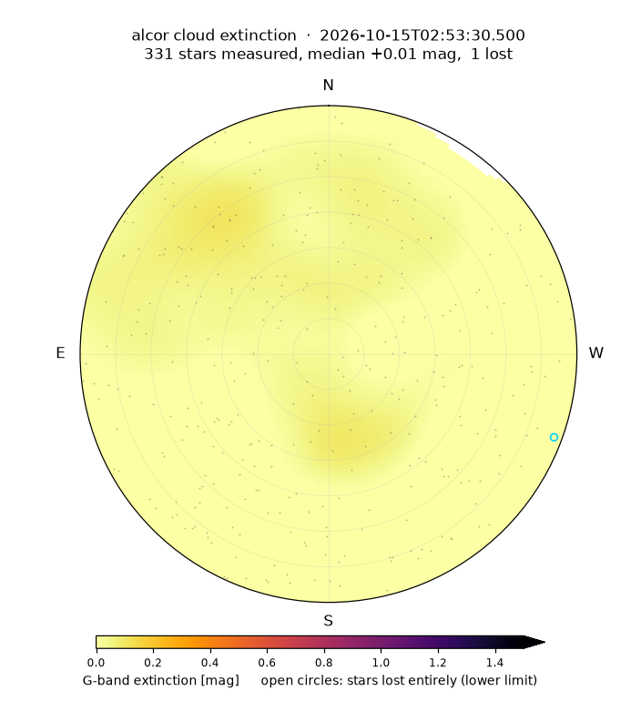

#######################
Cloud-extinction maps
#######################

Every frame's star photometry (:doc:`photometry`) already measures ``ext_g`` —
calibrated minus catalog magnitude — for a few hundred bright stars at known
(azimuth, altitude). That is a sparse, irregular sampling of the line-of-sight
extinction over the whole sky. :mod:`skycam_utils.alcor` turns it into a map:
it averages a short block of frames, smooths the surviving measurements onto
the sky, and writes the result in the camera's raw pixel frame with the alt/az
WCS attached, so a telescope pointing can be looked up directly.

   A 10-frame map from the clear night of 2026-10-14 (~5 min of data): 331
   stars measured, median +0.01 mag, flat across the sky to within a few
   hundredths. Dots are the contributing stars; an open circle marks a star
   lost entirely (a lower limit). This is the null result that sets the
   systematic floor.

How a map is built
==================

1. **Select stars** — :func:`~skycam_utils.alcor.alcor_extinction_stars`
   pools a block of per-frame ``*_phot.csv`` rows and keeps non-variable stars
   above ``ALCOR_EXT_MIN_ALTITUDE`` (20°) whose instrumental magnitude lies in
   ``ALCOR_EXT_MAG_WINDOW`` (−11.0 to −9.5). That window avoids both the
   bright-star CMOS non-linearity and the faint-end bias. Stars within
   ``ALCOR_EXT_HORIZON_MARGIN`` (8 px) of not-sky in the
   :doc:`horizon mask <horizon_mask>` are dropped, both as measurements and as
   lost stars. Photometry is fixed-position, so a star behind the flagpole or a
   building is still "measured", and light from the obstruction makes it read
   too *bright*. On the clear 2026-10-14 night, stars on or near not-sky read
   0.15–0.2 mag more negative than stars at the same altitude clear of it.
2. **Average the block** — each star's measurements are averaged over the
   block (default ``ALCOR_EXT_NFRAMES`` = 10 frames, ~5 min). That number is
   measured, not assumed. On a clear moonless night the scatter of block means
   follows the uncorrelated-noise line σ(1)/√N out to N ≈ 12, and has clearly
   departed from it by N = 30. It bottoms out near a ~0.02 mag per-star floor,
   so averaging longer cannot help.
3. **Smooth on a coarse grid** —
   :func:`~skycam_utils.alcor.alcor_extinction_grid` applies an 8° great-circle
   Gaussian kernel on a 1° alt/az grid. A grid cell is ``NaN`` where the summed
   kernel weight is below ``ALCOR_EXT_MIN_WEIGHT``. **Blanking rather than
   extrapolating is deliberate**: an unsampled region is exactly the one most
   likely to be heavily extinguished.
4. **Resample to the raw frame** —
   :func:`~skycam_utils.alcor.alcor_extinction_map` interpolates the grid onto
   every raw pixel. Smoothing on the grid and then resampling is a performance
   requirement. A direct kernel average over ~2 million pixels and ~350 stars
   is ~700 million great-circle distances per map. The same kernel on a 1° grid
   is ~11 million and runs in milliseconds, and a finer grid would not resolve
   an 8° kernel any better.

**Non-detections are tracked separately as lower limits.** A star behind thick
cloud has ``flux = 0``, so ``mag`` and ``ext`` are ``NaN``. Without special
handling it would silently vanish exactly where extinction is highest. A star
undetected for at least ``ALCOR_EXT_LOST_MIN_FRAMES`` frames of the block is
instead recorded with ``detected = False`` and drawn as an open marker.

The values that feed the map carry the full calibration from
:doc:`photometry`: frame registration, the de-blended zeropoints, the aperture
blending term, and the clear-night altitude flat. If a CSV was written before
the flat existed (it has no ``flat_<band>`` column), it is recalibrated on
read. That way a map from old photometry never mixes old and new terms. CSVs
from before the blend correction were also measured without registration, so
re-measure those frames for exact blend terms.

Output files and lookups
========================

:func:`~skycam_utils.alcor.alcor_extinction_fits` writes the map as a raw-frame
``float32`` image with the same alt/az ARC WCS as
:func:`~skycam_utils.alcor.alcor_sky_brightness_fits` and
:func:`~skycam_utils.alcor.alcor_proc_fits`, so all three overlay
pixel-for-pixel. A ``STARS`` binary table lists every contributing star.
Header keywords record how the map was made:

.. list-table::
   :header-rows: 1

   * - Keyword
     - Meaning
   * - ``NFRAMES``, ``TSTART``, ``TEND``, ``TMID``
     - frames in the block and their UT span
   * - ``EXTBAND``, ``EXTMETH``
     - photometric channel and method (aperture or Gaussian)
   * - ``KERNSIG``, ``MINWT``
     - smoothing kernel σ (deg) and the blanking weight
   * - ``MAGLO``, ``MAGHI``
     - the instrumental-magnitude window
   * - ``HORMARG``
     - horizon margin in px (``'none'`` when disabled)
   * - ``EXTFLAT``
     - the altitude flat applied, e.g. ``'altitude 2026-10-14'``
   * - ``PIXSCALE``
     - radial plate scale (px/deg)

:func:`~skycam_utils.alcor.alcor_extinction_at` resolves a pointing with one
``world_to_pixel`` call. It returns the median inside a cone of ``radius``
**degrees** (default 1°). The map is already 8°-smoothed, so the cone adds
almost no smoothing. Its job is to survive a blank pixel, a resampling edge, or
a pointing just outside the valid region.

.. code-block:: python

   from skycam_utils.alcor import alcor_extinction_fits, alcor_extinction_at

   alcor_extinction_fits("<night-dir>", output_file="ext.fits", latest=10,
                         overwrite=True)
   alcor_extinction_at("ext.fits", az=298.0, alt=43.0)   # mag at a pointing

Command line
============

.. code-block:: bash

   # One map from the 10 newest frames, plus a PNG, and the value at a pointing
   alcor_extinction_map <night-dir> -o ext.fits --plot ext.png --latest 10 \
       --at 298 43 --overwrite

   # Exit non-zero if the newest frame is older than 10 minutes, so a cron job
   # alerts instead of publishing a stale map that looks exactly like a current one
   alcor_extinction_map <night-dir> -o ext.fits --latest 10 --max-age 600

   # Re-render a saved map from its STARS table
   plot_alcor_extinction_fits ext.fits -o ext.png

   # Animate a night of maps (independent 10-frame blocks by default)
   alcor_extinction_movie <night-dir> -o night.mp4 --nframes 10

``--horizon-margin -1`` disables the horizon margin. ``--stride`` smaller than
``--nframes`` overlaps successive movie windows, which looks smoother but
correlates adjacent animation frames.

Operationally, a map is built every 5 minutes from the newest photometry, and
``scripts/mmt_extinction_redis.py`` (not packaged) publishes the value at the
MMT's pointing as ``allsky_extinction*`` keys. A raw-frame map is ~8 MB, so the
cron overwrites one rolling file rather than keeping every map. The night's
history lives in the movie.

What a map can and cannot tell you
==================================

On a clear night a map reads ~0 everywhere: on 2026-10-14 the medians were
about −0.01, the zenith about 0.00, and the MMT pointing (az 298°, alt 43°)
−0.06 to −0.01.

The absolute level, though, carries the instrument's slowly varying throughput
error. It is up to ~0.1 mag over months and ~0.07 within 2026-08..10 (see the
zeropoint notes in :doc:`photometry`). That is
larger than the ~0.05 mag that separates a clear night from thin cloud, so
judge a map's *structure*, and its level against neighbouring nights, before
reading anything into a uniform offset of a few hundredths.
