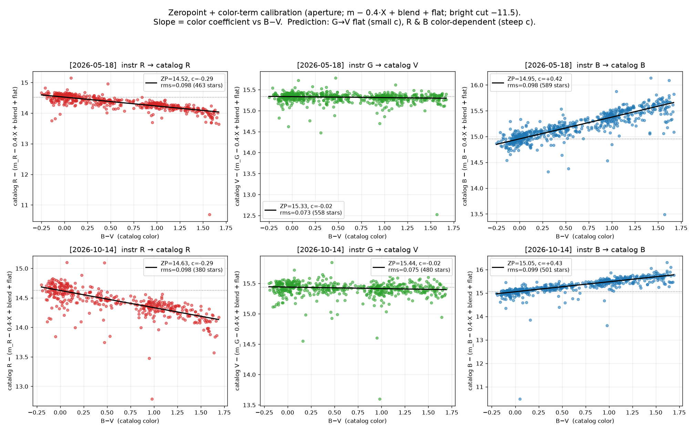
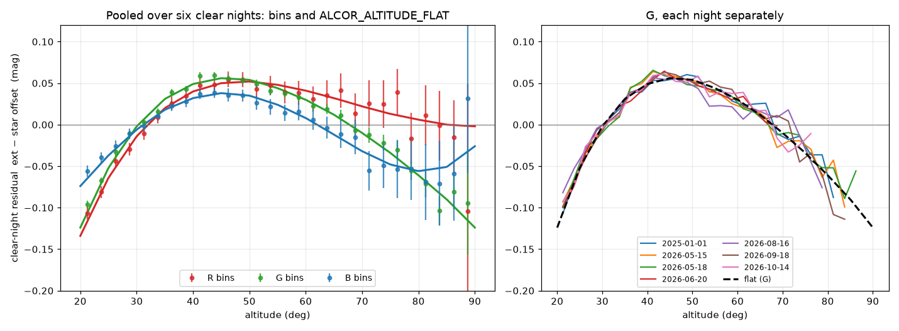
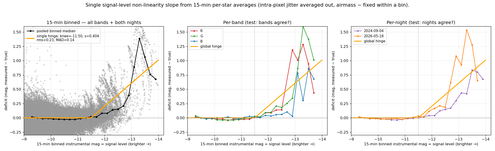
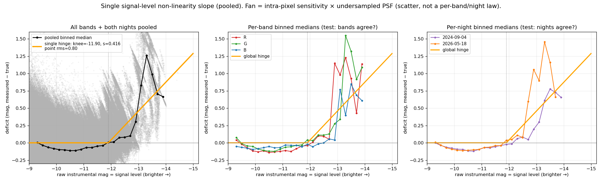

##########
Photometry
##########

Once the WCS pins every star's pixel position (see :doc:`wcs_calibration`),
photometry needs no source-detection step: ``skycam_utils`` measures each named
bright star at its **WCS-predicted** location. This page covers how those
instrumental measurements are made and how they are calibrated onto the catalog
magnitude system, including frame registration, the per-band colour terms,
aperture blending, the clear-night altitude flat, and the CMOS non-linearity
that sets the bright limit. The extinction values these produce are turned into
sky maps in :doc:`extinction_maps`.

Measuring instrumental magnitudes
=================================

:func:`~skycam_utils.alcor.alcor_star_photometry` performs fixed-position,
per-channel (R/G/B) photometry of named, non-variable stars from ``bright_star_sloan_named.fits``
(``Vmag <= --vmag-limit``, default 5.5; above ``--min-altitude``, default 20°).
Key behaviours:

- **Bias** — the per-channel pedestal (median of the four 10×10 image corners)
  is subtracted before measuring. The raw cube from
  :func:`~skycam_utils.alcor.load_alcor_fits` itself stays untouched.
- **Saturation flags** — a per-channel ``sat_*`` boolean is set when *any* raw
  aperture pixel reaches ``--saturation`` (default 32767, the camera's 15-bit
  ceiling). It is checked on the **raw** cube, so a star saturated in one
  channel can be filtered per-channel downstream without losing the others.
- **Non-detections are recorded, not dropped** — every catalog star above
  ``--min-altitude`` produces a row in *every* frame. A star behind cloud is
  recorded per-channel as ``flux = 0`` / ``mag = NaN`` rather than removed,
  because the non-detection is itself a strong extinction signal.
- **Daylight guard** — frames with the Sun above ``--sun-alt-max`` (−12° by
  default) are rejected with a warning and no CSV.
- **Frame registration** — the fitted WCS parameters are stationary, but the
  image itself *translates* on the sensor by 1–2 px over months (bright-star
  centroids minus WCS predictions are a pure shift, the same in every azimuth
  quadrant and stable to ±0.15 px within a night: ``dy`` ≈ −1.0 in 2025-01, 0.0
  on 2026-05-18 — the fitted epoch — and +1.3 to +1.8 from 2026-07 on). Rather
  than refit the WCS to chase it, every frame is registered: the median
  two-pass centroid offset of the ``V ≤ 4`` stars above alt 30° (~100 a frame)
  moves *all* apertures by one shift, so photometry stays fixed-position and a
  star behind cloud is still measured where it should be. With fewer than 10
  usable stars, or a shift over 4 px, the frame is left unshifted. Each row
  records ``frame_dx`` / ``frame_dy`` / ``frame_nreg``; ``--no-register`` turns
  it off. Registration alone cut a clear night's per-star ``ext_g`` scatter from
  0.20 to 0.14 mag, and the blend correction below depends on it.

The result is a :class:`pandas.DataFrame` indexed by star name, with
instrumental mags ``-2.5*log10(flux)``; a CSV (``<input>_phot.csv``) is always
written.

.. code-block:: bash

   # Fixed-position RGB aperture photometry of named bright stars
   alcor_star_photometry 2026_05_18__04_30_00.fits.bz2 \
       --aperture-radius 4 --annulus-width 1 --min-altitude 20 --vmag-limit 5.5

   # Overlay the apertures on the rendered frame for a sanity check
   alcor_star_photometry <input.fits> --check-plot

Aperture, Gaussian, and combined modes
======================================

Bright stars expose a CMOS non-linearity that suppresses the aperture-summed
flux *before* true saturation. Two alternative measurement paths address this:

- ``--gaussian`` fits a constrained circular Gaussian whose centre and width are
  pinned from a luminance (R+G+B) fit with the non-linear core masked (raw
  pixels ``>= --mask-threshold``, default 15000, excluded). Each channel's
  amplitude is recovered as the linear projection of the masked,
  background-subtracted aperture onto that fixed unit-Gaussian profile — so the
  *linear wings* set the amplitude — and the analytic integral
  :math:`2\pi A \sigma^2` is reported as ``flux_*``. A shared luminance ``fwhm``
  column is added.
- ``--both`` measures aperture **and** Gaussian in one pass into a single CSV,
  with columns suffixed ``_ap`` / ``_gauss`` (plus the shared WCS-predicted
  ``xcen``/``ycen`` and the Gaussian-fitted ``xcen_gauss``/``ycen_gauss``/``fwhm``).
  Rows sort by ``flux_g_ap``. This is useful for measuring both methods on
  identical frames in one parallelized run for direct comparison.

.. code-block:: bash

   alcor_star_photometry <input.fits> --gaussian          # constrained-PSF flux
   alcor_star_photometry <input.fits> --both              # both in one combined CSV

Photometric calibration
=======================

Every measured magnitude is converted to the catalog system, and
:func:`~skycam_utils.alcor.alcor_star_photometry` always writes per-channel
``cal_*`` (calibrated catalog-system magnitude) and ``ext_*`` (the
line-of-sight extinction in magnitudes, positive when the star is dimmer than
expected) columns, plus the two correction terms ``blend_*`` and ``flat_*``
described below. The reusable DataFrame helper is
:func:`~skycam_utils.alcor.alcor_calibrate_photometry`, which applies

.. math::

   m_{\rm cal} &= m_{\rm inst} - k\,X - F_b({\rm alt}) + {\rm ZP}_b + c_b\,(B-V) \\
   {\rm ext}   &= m_{\rm cal} - (m_{\rm cat} + \beta_b)

with Kasten–Young airmass :math:`X`, a single achromatic extinction term
``ALCOR_AIRMASS_TERM`` :math:`k = 0.40` mag/airmass, the clear-night altitude
flat :math:`F_b` (``flat_*``; see `The altitude flat`_), per-band ``ZP`` and
colour coefficient :math:`c` from the time-indexed ``ALCOR_ZEROPOINTS`` table
(resolved by :func:`~skycam_utils.alcor.alcor_zeropoint`), and the aperture
blending term :math:`\beta_b \le 0` (``blend_*``; see `Aperture blending`_).
The blend term is subtracted only from the *reference*, so ``cal_*`` stays the
measured, blended light. The channel→catalog mapping is **G→V**, **R→R**
(= V − (V−R)), **B→B** (= V + (B−V)). ``blend=False`` and ``flat=False``
switch the two corrections off.

``cal_*`` / ``ext_*`` are ``NaN`` where the instrumental magnitude is brighter
than ``ALCOR_BRIGHT_CUT = -12.5`` (the CMOS non-linear regime — see below) or
where the star lacks a catalog colour. Variable stars (measured by default from
``bright_variable_vsx.fits``) get a real ``cal_*`` — their light curve — but
``ext_*`` of ``NaN``, since they have no single catalog magnitude.

Colour terms
============

The colour terms are where the per-channel structure of the calibration shows
up most clearly. Each channel's response is fit as ``catalog − (m_inst − 0.4·X −
blend − flat)``, per star (a median over a night's clean frames), regressed
against the catalog colour ``B−V``: the intercept is the zeropoint and the
**slope is the colour coefficient**. The fit is
``claude_docs/scripts/zeropoint_calib.py --blend --flat``. Based on published photometric behavior of
similar on-sensor colour (OSC) CMOS cameras (the OMEA 8C uses a ZWO ASI294MC), the
prediction is that the green channel tracks Johnson *V* closely (small slope)
while R and B carry real colour terms. These colour terms are due to differences
between the camera's bandpass shapes and the standard Johnson system, specifically
leaks well away from the effective center wavelengths. These terms are expected
to be stable over time, but infrastructure is in place to add new epochs if they're needed.

   Zeropoint + colour-term calibration (aperture mags, ``k = 0.40``/airmass,
   de-blended and with the altitude flat). Each panel is one star. **Top:**
   2026-05-18. **Bottom:** 2026-10-14. **G→V** is nearly flat (``c ≈ -0.02``),
   while **R→R** (``c ≈ -0.29``) and **B→B** (``c ≈ +0.42``) are strongly
   colour-dependent — exactly as the instrument bandpasses predict. The colour
   term takes the per-star rms from ~0.21 to 0.098 mag in R and from ~0.26 to
   0.098 in B; in G it is 0.073–0.075 mag.

The shipped zeropoints are:

.. list-table::
   :header-rows: 1

   * - Epoch
     - R zp / c
     - G zp / c
     - B zp / c
     - Note
   * - 2024-09-05
     - 14.559 / −0.274
     - 15.340 / −0.001
     - 14.927 / +0.434
     - shifted by 2026-05's de-blending change, not refit
   * - 2026-05-19
     - 14.521 / −0.287
     - 15.331 / −0.022
     - 14.961 / +0.415
     - de-blended refit
   * - 2026-10-15
     - 14.618 / −0.285
     - 15.429 / −0.013
     - 15.058 / +0.422
     - de-blended fit of 2026-10-14

The nearest epoch to a frame is used. The two original epochs (2024-09 and
2026-05) agree to ~0.03 mag, mirroring the geometric stability documented in
:doc:`wcs_calibration`, but **that is a statement about those two dates, not
the time between them**: the instrument's throughput wanders by ~0.1 mag
over months — the observer attributes it to the acrylic dome being washed and
then re-soiling — and 2026-10-15 sits ~0.1 above May in every band for that
reason. Within 2026-08..10 the G level moves by ~0.07 from night to night under
a single epoch (2026-08-16 reads +0.09 under the October zeropoints). Absolute
``cal_*`` / ``ext_*`` therefore carry a slowly-varying error up to ~0.1 mag;
grade a night against its neighbours rather than against zero. A
time-dependent zeropoint is the real fix and is not yet in place.

Aperture blending
=================

The 4 px aperture is ~0.5° across (the plate scale is only 6.6–8.3 px/deg), so
the light of neighbouring stars lands in it. Left alone this reads as a
*negative* extinction: ~80% of the stars used for extinction maps carry more
than 1% neighbour flux (Hipparcos ``V < 9.5``), per-star ``ext`` tracks the
predicted blend at r ≈ 0.7 on every night tested, and on the clear
2026-10-14 night it was most of a −0.11 mag median offset — and all of a
−0.2 mag reading at the MMT's pointing, where HD 166229 (blended with
HIP 89008, 24′ away; predicted −0.79, measured −0.79) pulled the map.

:func:`~skycam_utils.alcor.alcor_blend_terms` computes, per row and band,

.. math::

   \beta = -2.5\log_{10}\Big(1 + e\sum_n 10^{-0.4(m_n - m)}\,
            \frac{f(d_n)}{f(0)}\Big)

where :math:`f(d)` is the fraction of a Gaussian PSF (σ =
``ALCOR_BLEND_PSF_SIGMA`` = 0.68 px) offset by :math:`d` pixels that falls
inside the aperture (a Rice CDF), and :math:`e` = ``ALCOR_BLEND_EFFICIENCY`` =
0.9 is the measured fraction of a neighbour's predicted flux the aperture
actually records (a joint fit gave 0.87 and 0.91 on two nights, flat in
neighbour brightness and distance). The neighbours come from
``bright_star_neighbors.fits`` (every Hipparcos star within 0.8° of each
calibration star, as east/north offsets; built by
``claude_docs/scripts/build_neighbor_catalog.py``). The offsets are projected
*per row*, because which neighbours fall inside depends on where the star is:
the aperture is a 0.61 × 0.39° ellipse at alt 20° and a 0.48° circle at the
zenith, so offsets are rotated into the local radial/tangential frame by the
parallactic angle and scaled by the WCS plate scales at that altitude.

Two details are easy to get wrong. Finding a star's *own* Hipparcos entry: the
catalog and Hipparcos positions differ by up to ~40″, but the nearest
V-consistent entry within 30″ must be tried before searching wider, or the twin
of an equal pair (24/25 Dra, 62″ apart) is taken for the star itself. And the
aperture must be centred — which is what frame registration is for; 1.4 px off
centre, the model over-predicted by ~1/0.7.

The zeropoints above are de-blended to match. The old fits had absorbed the
average neighbour light (~0.1 mag in G), and de-blending cut the zeropoint
fit's per-star rms from 0.134 to 0.078 mag in G.

The altitude flat
=================

With blending and registration fixed, clear-night ``ext`` still had a fixed
dependence on altitude: in G, −0.12 at alt 20°, +0.06 at alt 45° and −0.11 at
the zenith. It is a property of the **instrument**, and the evidence is that it
does not move:

- per-night bins agree to ~0.01 mag on seven clear nights from 2025-01-01 to
  2026-10-14, spanning winter, spring, the monsoon and autumn;
- it is azimuthally symmetric to ~0.01 mag;
- at a fixed altitude, bright and faint stars agree to ~0.01 mag, so it is not
  a magnitude effect (a star reads ~0.6 mag fainter at alt 25° than at the
  zenith, so this had to be ruled out).

The single 0.40 airmass term over-corrects low altitudes (as if :math:`k`
were ~0.28) and stars near the optical axis read bright (vignetting). For a
fixed all-sky camera the two cannot be separated, so the correction is
empirical: ``ALCOR_ALTITUDE_FLAT`` holds per-band values at 5° nodes from
alt 20° to 90° (held at the end values outside),
:func:`~skycam_utils.alcor.alcor_altitude_flat` interpolates it, and
``ALCOR_AIRMASS_TERM`` stays 0.40.

   **Left:** clear-night residuals (``ext`` minus a per-night, per-star offset,
   isolated stars) in 2.5° bins, pooled over six registered nights, with the
   shipped flat (lines). **Right:** the G bins of each night separately — the
   shape is the same on every night.

The table is derived by ``claude_docs/scripts/altitude_flat.py``: a quartic in
zenith distance through the binned residuals, with stars selected on their
*expected* instrumental magnitude (``mag − ext``) rather than the noisy measured
one, which would bias the faint edge. Its overall level is degenerate with the
zeropoints and is left as measured — applying it moves the zeropoint fits by
≤ 0.01 mag with mixed sign, inside how well a refit reproduces at all — while
the fit's per-star rms drops from 0.097 to 0.075 in G. With the flat, a clear
night's ``ext_g`` varies by ~0.03 across altitude, down from ~0.15. Nightly
extinction slopes stay within ±0.04 mag/airmass of the model, which is part of
why a fixed flat works. The flat corrects star photometry only; it is not
applied to surface-brightness maps (:doc:`sky_brightness`).

CMOS non-linearity and the bright cut
=====================================

For bright stars (roughly ``V < 3``) the measured flux is suppressed before the
pixels saturate — a property of the signal level, not of any particular band.
The deficit was characterized with 15-minute per-star medians (which average out
the intra-pixel-sensitivity × undersampled-PSF jitter), revealing a single,
band- and night-independent function of signal level.

   The bright-star magnitude deficit as a function of instrumental signal level
   (15-minute binned). The deficit onsets near ``-11.5`` but stays small and
   roughly linear (~0.15–0.20 mag/mag) out to ``-12.5``, then accelerates
   steeply into a sparse, inconclusive regime.

Because the deficit stays small and nearly linear out to ``-12.5`` before
accelerating, ``ALCOR_BRIGHT_CUT`` was set there: measurements brighter than
``-12.5`` are flagged non-linear and their ``cal_*`` / ``ext_*`` are set to
``NaN``. The Gaussian path does **not** rescue this regime — the PSF is
undersampled, so the constrained fit inherits the same core suppression.

   Combined view of the deficit across bands and nights, showing the collapse
   onto a single signal-level relation.

Building light curves across a night
====================================

:func:`~skycam_utils.alcor.collect_alcor_photometry` gathers a set of per-frame
CSVs (a directory globbed for ``*_phot.csv``, or an explicit path list) into one
DataFrame with a UT ``OBSTIME`` column parsed from each
``YYYY_MM_DD__HH_MM_SS`` filename, sorted by ``name`` then ``OBSTIME`` — so
``df.groupby("name")`` yields each star's time-ordered light curve for
calibration against catalog photometry. It is column-agnostic (it only needs
``name``), so the wider ``--both`` schema flows through unchanged.

.. code-block:: python

   from skycam_utils.alcor import collect_alcor_photometry

   df = collect_alcor_photometry("<skycam_datadir>/2026-05-18")
   for name, lc in df.groupby("name"):
       ...  # lc is one star's time-ordered light curve

See :doc:`reference/index` for the full :mod:`skycam_utils.alcor` API.
